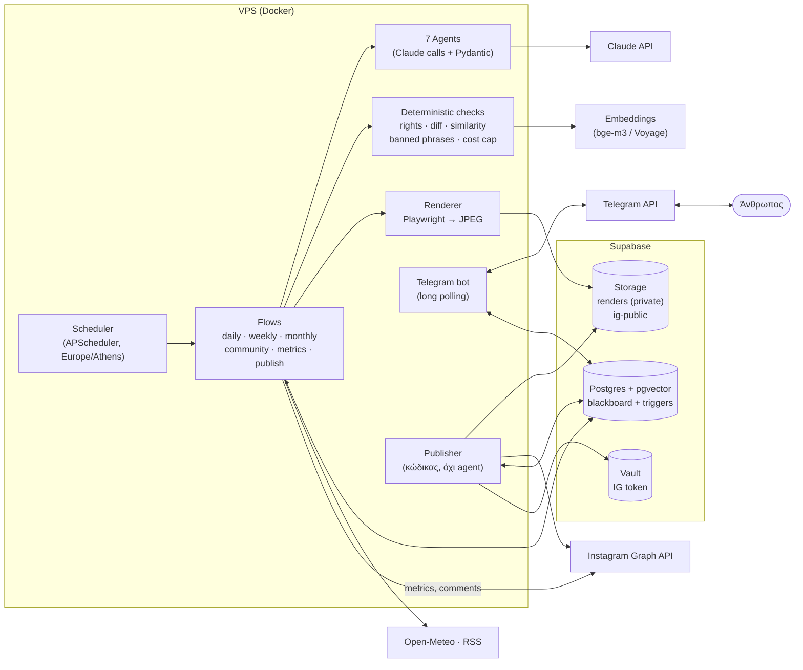
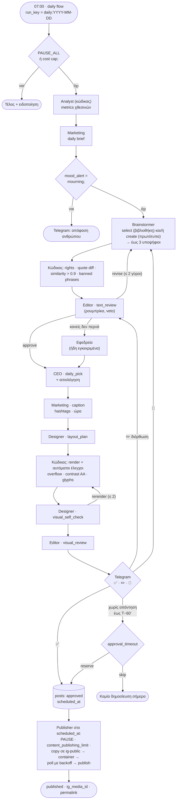

# Αρχιτεκτονική (v0.1, προς έγκριση)

> Παραδοτέα 1–3 της πρώτης απάντησης: διάγραμμα ροής, δομή repo, schema.
> Τα prompts των agents είναι στο [`agents/`](../agents), οι ανοιχτές ερωτήσεις και τα ρίσκα στο [`OPEN_QUESTIONS.md`](OPEN_QUESTIONS.md).

## 1. Βασικές σχεδιαστικές αποφάσεις

| # | Απόφαση | Γιατί |
|---|---|---|
| D1 | **Η ροή είναι κώδικας, οι agents είναι κλήσεις κρίσης.** Κάθε agent είναι μία κλήση Claude Messages API με δικό του system prompt και structured output (Pydantic, `client.messages.parse`). Χωρίς ελεύθερο tool-loop. | Προβλέψιμο, φθηνό, αναπαραγώγιμο, εύκολο στο test. Ο CEO αποφασίζει, αλλά τη σειρά των βημάτων, τα retries και τα timeouts τα ελέγχει ο κώδικας. |
| D2 | **Όχι Claude Agent SDK** (προτείνω απόκλιση από την ενότητα 0). Χρησιμοποιούμε το `anthropic` Python SDK. | Το Agent SDK είναι το harness του Claude Code (bash, αρχεία, tool loops), για ανοιχτές εργασίες. Εδώ κάθε βήμα είναι μία δομημένη απόφαση. Αν κάποιος ρόλος χρειαστεί αργότερα πραγματικά εργαλεία (π.χ. έρευνα), το ξαναβλέπουμε. |
| D3 | **Blackboard = Supabase.** Ο κώδικας συγκεντρώνει το context από τη βάση, καλεί τον agent και γράφει το αποτέλεσμα. Οι agents δεν έχουν πρόσβαση στη βάση. | Κάθε απόφαση καταγράφεται (`agent_runs`, `decisions`, `reviews`) με input, output, tokens, κόστος και hash του prompt. |
| D4 | **Guardrails σε 3 επίπεδα:** (α) prompt, (β) κώδικας (rights, diff, similarity, banned phrases, PAUSE_ALL, cost cap), (γ) **triggers στη βάση**. | Ακόμα κι αν ο κώδικας έχει bug, η βάση αρνείται `publishing` χωρίς δικαιώματα/έγκριση ή με PAUSE_ALL, και αρνείται απόσπασμα που δεν είναι αυτούσιο. Έχει ήδη δοκιμαστεί τοπικά σε Postgres 16 + pgvector. |
| D5 | **Από τη στιγμή που ένα ποίημα μπει στη βάση, το κείμενό του δεν ξαναπερνά από LLM προς τη δημοσίευση.** Brainstormer και Designer δηλώνουν *αριθμούς στίχων*. Το κείμενο στις εικόνες και στο caption το βάζει ο κώδικας από τη βάση. Διορθώσεις σε πρωτότυπα γίνονται μόνο ως νέα έκδοση στη βάση, με έγκριση. | Μηδενικός κίνδυνος να «διορθώσει» ένα LLM μια λέξη του Καβάφη. |
| D6 | **Rights υπολογίζονται δυναμικά** από το τρέχον έτος (`effective_rights()`), με cache στο `poems.rights_status` και nightly refresh. | Την 1/1/2028 ο Καζαντζάκης γίνεται διαθέσιμος χωρίς αλλαγή κώδικα. |
| D7 | **Renders μέσω HTML/CSS templates + Playwright → JPEG.** Ιδιωτικό bucket `renders`· αντιγραφή σε δημόσιο `ig-public` μόνο τη στιγμή της δημοσίευσης, διαγραφή μετά. | Συνέπεια brand, σωστή ελληνική τυπογραφία, καμία διαρροή μη εγκεκριμένων εικόνων μέσω δημόσιου URL. |
| D8 | **Hosting: μικρό VPS** (π.χ. Hetzner CX22, ~€4,5/μήνα) με Docker: scheduler + Telegram bot (long polling) + Playwright. | Το GitHub Actions cron καθυστερεί (συχνά 5–30') και δεν δέχεται callbacks από κουμπιά Telegram. Με long polling δεν χρειάζεται δημόσιο endpoint. *Απόφαση δική σου: βλ. OPEN_QUESTIONS Q2.* |
| D9 | **Embeddings: `vector(1024)`**, με προεπιλογή το ανοιχτό `bge-m3` τοπικά (δωρεάν, πολύγλωσσο, καλό στα ελληνικά) ή Voyage. | Η Anthropic δεν προσφέρει embeddings API. *Απόφαση: Q3.* |
| D10 | **Idempotency:** `pipeline_runs.run_key` unique (`daily:2026-11-20`) + partial unique index «ένα ζωντανό post ανά ημέρα/slot». Ο publisher ξαναελέγχει `ig_media_id` πριν από κάθε βήμα. | Αν ο cron τρέξει δύο φορές, δεν βγαίνει διπλό post. |

## 2. Διάγραμμα συστήματος



## 3. Ημερήσια ροή



**Παράλληλα όλη τη μέρα:** Community Manager κάθε 2–3 ώρες (σχόλια → ταξινόμηση → απάντηση / hide / άμεση ειδοποίηση για `distress`).
**Κυριακή βράδυ:** Analyst report → CEO ενημερώνει `strategy.md` → Marketing draft ημερολογίου 7 ημερών → Brainstormer γεμίζει εφεδρεία 5 posts (Batch API, −50% κόστος).
**Μηνιαία:** CEO προτείνει 1 πείραμα format + 1 πείραμα θέματος· ξεκινούν μόνο με έγκριση ανθρώπου.

### Σημεία ανθρώπινης παρέμβασης (Φάσεις 1–2)
- Έγκριση κάθε post (✅ / ✏️ / 🔁) στο Telegram.
- `mood_alert = mourning` → ο άνθρωπος αποφασίζει.
- `distress` σχόλια → άμεση ειδοποίηση με προτεινόμενη απάντηση (1018 / 10306 / 112).
- `/pause` και `/resume` από το Telegram (γράφει στο `system_flags.pause_all`).
- Ειδοποιήσεις: αποτυχία δημοσίευσης, token που λήγει σε < 7 ημέρες, cost cap, απότομη πτώση reach.

## 4. Δομή repo

```
poems_instagram/
├── CLAUDE.md                      # Κανόνες εργασίας για το Claude Code
├── README.md
├── pyproject.toml                 # Python 3.12, uv
├── .env.example                   # Ονόματα μεταβλητών, χωρίς τιμές
├── strategy.md                    # Ενεργή στρατηγική (mirror του strategy_versions)
├── agents/                        # System prompts, versioned
│   ├── _shared/brand.md           #   κοινό μπλοκ φωνής & guardrails (cache-friendly)
│   ├── ceo.md
│   ├── brainstormer.md
│   ├── marketing.md
│   ├── designer.md
│   ├── editor.md
│   ├── community_manager.md
│   └── analyst.md
├── config/
│   ├── settings.toml              # μοντέλα ανά agent, effort, κατώφλια, caps, ώρες
│   ├── templates.yaml             # templates: όρια στίχων/χαρακτήρων, fonts, polytonic
│   ├── hashtags.yaml              # εγκεκριμένη λίστα hashtags
│   └── banned_phrases.txt         # seed (η ζωντανή λίστα ζει στη βάση)
├── supabase/
│   ├── migrations/0001_init.sql
│   └── seed/
│       ├── calendar_events.sql    # γιορτές, ονομαστικές, Πανελλήνιες, επέτειοι ποιητών
│       └── people.sql             # ποιητές με ημερομηνίες γέννησης/θανάτου
├── src/poems_ig/
│   ├── cli.py                     # `poems run daily --dry-run`, `poems ingest ...`
│   ├── core/
│   │   ├── config.py              # settings + env (pydantic-settings)
│   │   ├── db.py                  # Supabase/Postgres access
│   │   ├── llm.py                 # Claude wrapper: caching, cost logging, daily cap, fallbacks
│   │   ├── killswitch.py          # PAUSE_ALL (env Ή βάση)
│   │   └── logging.py
│   ├── agents/
│   │   ├── base.py                # φόρτωση prompt + hash, κλήση, καταγραφή agent_run
│   │   ├── schemas.py             # Pydantic outputs όλων των agents
│   │   └── ceo.py · brainstormer.py · marketing.py · designer.py
│   │       editor.py · community_manager.py · analyst.py
│   ├── rights/
│   │   ├── copyright.py           # mirror της effective_rights() + tests
│   │   └── quote_diff.py          # NFC normalisation, diff με source_text_snapshot
│   ├── library/
│   │   ├── ingest/wikisource.py   # εισαγωγή από Βικιθήκη (με source_url)
│   │   ├── normalize.py           # NFC, ελληνικό ερωτηματικό, κενά, στίχοι
│   │   ├── enrich.py              # Brainstormer.enrich μέσω Batch API
│   │   └── embed.py
│   ├── calendar/
│   │   ├── orthodox_easter.py
│   │   ├── namedays.py            # συμπ. κινητών εορτών (π.χ. Αγ. Γεωργίου)
│   │   └── context.py             # καιρός (Open-Meteo), RSS mood
│   ├── design/
│   │   ├── templates/*.html       # 2 στη Φάση 1, 4–6 αργότερα
│   │   ├── fonts/                 # self-hosted OFL fonts (GFS Didot, Noto Serif …)
│   │   ├── render.py              # Playwright → JPEG 1080×1350 / 1080×1920
│   │   └── checks.py              # overflow, contrast, glyph fallback, τόνοι
│   ├── instagram/
│   │   ├── client.py              # Graph API, backoff, rate-limit headers
│   │   ├── tokens.py              # long-lived token refresh → Vault
│   │   ├── publisher.py           # container → poll → publish, idempotent
│   │   ├── insights.py
│   │   └── comments.py
│   ├── telegram/
│   │   ├── bot.py                 # long polling, /pause /resume /status
│   │   └── approval.py            # preview + ✅ ✏️ 🔁, deadlines
│   └── flows/
│       ├── daily.py · weekly.py · monthly.py
│       ├── community.py · metrics.py · publish.py
├── dashboard/                     # Φάση 2 (admin)
├── tests/
│   ├── unit/                      # rights, diff, Easter, idempotency, schemas
│   ├── db/                        # τα triggers της βάσης (Postgres σε Docker)
│   ├── golden/                    # golden renders για visual regression
│   └── fixtures/
├── deploy/
│   ├── Dockerfile
│   └── docker-compose.yml
└── .github/workflows/ci.yml       # lint, tests, migration check
```

## 5. Μοντέλα ανά agent και εκτίμηση κόστους

Τιμές Claude API (ανά 1M tokens, input / output): Opus 5.5 $4 / $20 · Sonnet 5.5 $2 / $10 · Haiku 5.5 $0,10 / $0,50. Batch API: −50%. Cache reads: Opus $0,20, Sonnet $0,10.

| Agent / εργασία | Μοντέλο | Effort | ≈ κόστος |
|---|---|---|---|
| Brainstormer · create | Opus 5.5 | high | $0,25–0,30 / ημέρα |
| Brainstormer · select | Opus 5.5 | medium | $0,05 / ημέρα |
| Brainstormer · enrich (εφάπαξ, 300 ποιήματα) | Sonnet 5.5 · Batch | medium | ~$3 εφάπαξ |
| Editor · text + visual | Opus 5.5 | high | $0,20–0,25 / ημέρα |
| Γύρος αναθεώρησης (~40% των ημερών) | Opus 5.5 | | ~$0,15 / ημέρα κατά μ.ό. |
| CEO · daily_pick | Opus 5.5 | medium | $0,06 / ημέρα |
| Marketing · brief + caption | Sonnet 5.5 | medium | $0,06 / ημέρα |
| Designer · plan + vision check | Sonnet 5.5 | medium | $0,05 / ημέρα |
| Community · classify | Haiku 5.5 | low | < $0,01 / ημέρα |
| Community · replies (~20/ημέρα) | Sonnet 5.5 | medium | ~$0,12 / ημέρα |
| Εβδομαδιαία (Analyst, CEO strategy, εφεδρεία μέσω Batch) | Sonnet / Opus | high | ~$0,70 / εβδομάδα |

**Σύνολο:** ≈ **$0,85–1,05 / ημέρα → ~$26–32 / μήνα (≈ €24–30)**. Χωράει στα €30 αλλά οριακά. Το μεγαλύτερο άγνωστο είναι τα thinking tokens. Γι' αυτό:
- **Hard caps στον κώδικα:** `daily_cost_cap_usd = 2,00`, `monthly_cost_cap_usd = 32`. Όταν ξεπεραστούν, το flow σταματά καθαρά (δεν δημοσιεύει) και ειδοποιεί.
- **Spend limit και στο Anthropic Console** ως δεύτερο δίχτυ.
- Prompt caching στο κοινό `brand.md` και στα system prompts.
- Αν χρειαστεί περιθώριο: Editor visual review σε Sonnet, Editor text σε effort medium. Θα το μετρήσουμε με πραγματικά dry runs στη Φάση 1 πριν αλλάξουμε κάτι.

Όπου χρησιμοποιούμε Opus/Sonnet 5.5, ενεργοποιούμε το server-side `fallbacks: "default"` για τις σπάνιες περιπτώσεις που ένας safety classifier αρνηθεί αίτημα.

## 6. Instagram Graph API: τι υποθέτουμε (επαλήθευση στη Φάση 0)

Δεν μπόρεσα να ανοίξω τα docs της Meta από αυτό το session (το `developers.facebook.com` δεν επιτρέπεται στο δίκτυό του). Τα παρακάτω είναι από τη γνώση μου και **θα επαληθευτούν στα τρέχοντα docs πριν γραφτεί κώδικας**:

- **Δύο διαδρομές login.** *Instagram Login*: απλούστερη, χωρίς Facebook Page, καλύπτει publishing, σχόλια και insights. *Facebook Login*: απαιτεί Facebook Page συνδεδεμένη με τον λογαριασμό, αλλά είναι η μόνη που δίνει **Hashtag Search** και **Business Discovery**. Αν θέλουμε τα δύο τελευταία (ενότητα 6.3 του brief), χρειαζόμαστε Facebook Login.
- Για χρήση μόνο στον δικό μας λογαριασμό, η εφαρμογή μπορεί να μείνει σε development mode/Standard Access με τον λογαριασμό μας σε ρόλο της app. Το Hashtag Search πιθανότατα απαιτεί app review για το feature «Instagram Public Content Access».
- Publishing: μόνο JPEG για εικόνες· carousel έως 10 στοιχεία μέσω API· stories υποστηρίζονται για professional accounts (χωρίς interactive stickers)· reels μόνο με δικό μας ήχο· **χωρίς** native scheduling μέσω API (γι' αυτό ο δικός μας scheduler).
- Το όριο δημοσιεύσεων το διαβάζουμε πάντα από `GET /<IG_ID>/content_publishing_limit`.
- Insights: το `impressions` έχει αντικατασταθεί από `views`. Υπάρχουν `reach`, `saved`, `shares`, `comments`, `likes`, `total_interactions`, `follows`, `profile_visits`. **Δεν υπάρχει ξεχωριστό metric για DM sends**, άρα το KPI «sends/reach» μετριέται ως `shares/reach`.
- Long-lived token: 60 ημέρες, ανανέωση με job ανά εβδομάδα και αποθήκευση στο Supabase Vault.
